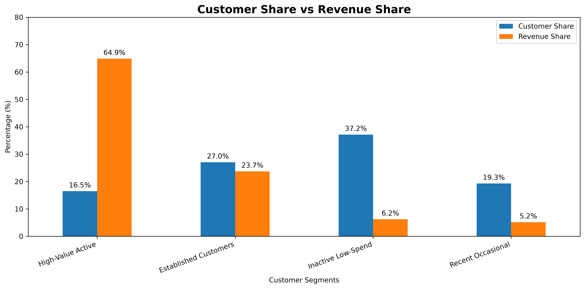

# Customer Segmentation Using Python & Machine Learning

### RFM Analysis | K-Means Clustering | Customer Analytics | Business Insights

## Project Overview

This project analyzes historical e-commerce transactions to identify customer purchasing patterns and group customers into meaningful segments using Python and Machine Learning.

The objective is to understand customer behavior, compare spending patterns, and develop data-driven business recommendations.

The analysis combines **RFM (Recency, Frequency, Monetary) Analysis**, **K-Means Clustering**, statistical evaluation, and data visualization.

## Technologies Used

- **Python** — Data analysis and programming
- **Pandas & NumPy** — Data cleaning and transformation
- **Matplotlib** — Data visualization
- **Scikit-learn** — K-Means clustering and preprocessing
- **Jupyter Notebook** — Analysis and experimentation
- **Joblib** — Saving the trained ML model

## Dataset

**Source:** UCI Machine Learning Repository — Online Retail Dataset

https://archive.ics.uci.edu/dataset/352/online+retail

The dataset contains historical retail transactions from December 2010 to December 2011.

**Data Preparation Results:**

- Original transaction records: 541,909
- Valid purchase records after cleaning: 397,884
- Unique customers analyzed: 4,338

The cleaning process excluded records with missing Customer IDs, cancelled transactions, non-positive quantities, and non-positive unit prices.

## Project Workflow

1. Data loading and exploratory analysis
2. Missing value identification and data cleaning
3. Transaction-level sales calculation
4. Customer-level RFM analysis
5. RFM scoring and rule-based segmentation
6. Log transformation and standard scaling
7. K-Means clustering
8. Elbow Method and Silhouette Score evaluation
9. Customer cluster profiling
10. Revenue contribution analysis
11. Business recommendations
12. Model and results export

## Machine Learning Approach

K-Means clustering was applied to three customer-level features:

- **Recency:** Days since a customer's last purchase
- **Frequency:** Number of unique purchase invoices
- **Monetary:** Total historical purchase value

Log transformation and standard scaling were applied before clustering.

The highest Silhouette Score among the tested configurations was **0.4329 with K=2**.

A **K=4 model**, with a Silhouette Score of **0.3371**, was also developed for more detailed, business-oriented customer segmentation.

## Customer Segmentation Results

| Customer Segment | Customers | Customer Share | Purchase Value Share |
|---|---:|---:|---:|
| High-Value Active | 716 | 16.51% | 64.87% |
| Established Customers | 1,173 | 27.04% | 23.73% |
| Recent Occasional | 837 | 19.29% | 5.18% |
| Inactive Low-Spend | 1,612 | 37.16% | 6.21% |

## Key Business Findings

**High-Value Active Customers**

Only 16.51% of customers contributed approximately 64.87% of historical positive purchase value.

**Established Customers**

These customers accounted for 23.73% of purchase value, suggesting opportunities to encourage repeat purchases.

**Inactive Low-Spend Customers**

This segment represented 37.16% of customers but contributed only 6.21% of purchase value.

**Potential Business Actions**

- Explore loyalty rewards for high-value customers.
- Test personalized offers for established customers.
- Encourage repeat purchases among recent occasional customers.
- Evaluate targeted re-engagement campaigns for inactive customers.

These recommendations are hypotheses for further business testing, not guaranteed outcomes.

## Data Visualization

The chart compares each segment's share of total customers with its contribution to historical purchase value.

## Project Files

| File | Description |
|---|---|
| Customer_Segmentation.ipynb | Complete data analysis and ML workflow |
| Customer_Segments.csv | Customer-level segmentation results |
| customer_segmentation_model.joblib | Saved model and preprocessing settings |
| Segment_Revenue_Summary.csv | Segment-level revenue analysis |
| Business_Recommendations.csv | Suggested business actions |
| Customer_vs_Revenue_Share.png | Customer and revenue comparison chart |

## How to Run

1. Download or clone the repository.
2. Download the Online Retail dataset from UCI.
3. Place `Online Retail.xlsx` in the project folder.
4. Install the required Python libraries.
5. Open `Customer_Segmentation.ipynb` in Jupyter Notebook.
6. Run the notebook cells in order.

## Limitations

The customer segments are based on historical transactions and the selected K-Means configuration.

The reported purchase values exclude cancelled transactions and returns, so they should not be interpreted as net accounting revenue.

Cluster descriptions are interpretations of group-level behavior rather than guarantees about individual customers.

## Conclusion

This project demonstrates an end-to-end customer analytics workflow, from raw transactional data to Machine Learning segmentation and actionable business insights.

It highlights practical skills in Python, data preprocessing, exploratory analysis, unsupervised Machine Learning, visualization, and business analytics.

---

**Author:** Seerat Hussain

**GitHub:** https://github.com/seerathussain0

**Focus:** Data Analytics | Data Science | Python | Machine Learning